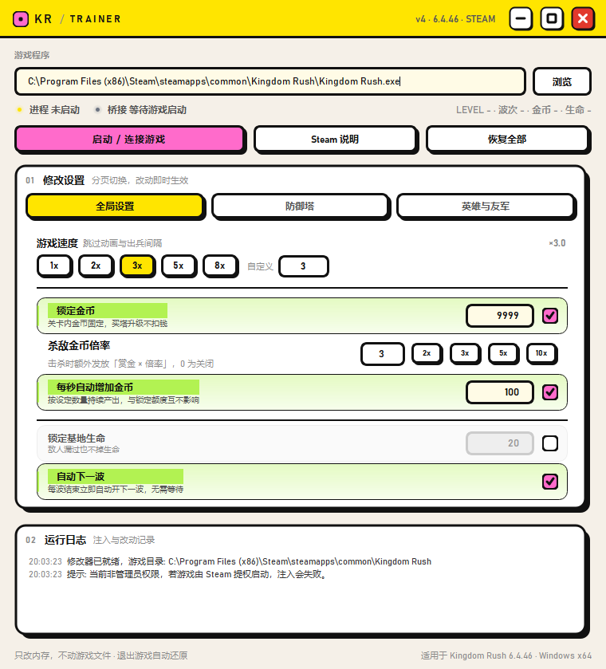
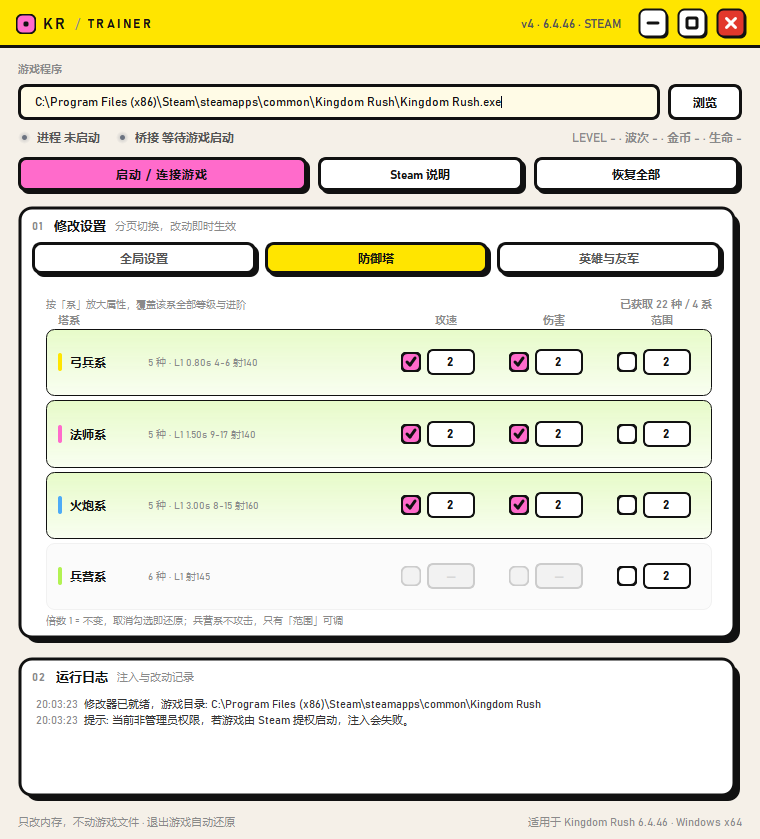
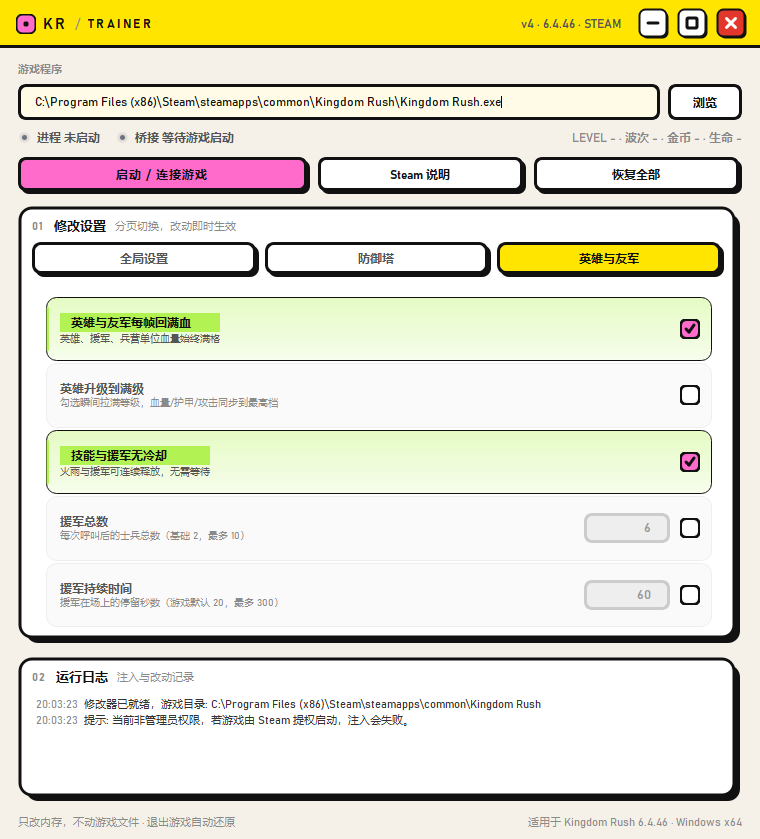

# Kingdom Rush 修改器（非官方）

单文件 Windows 修改器，注入 Lua 脚本读写游戏内存数值。**不改游戏文件、不联网、退出游戏即还原。**

> 非官方爱好者工具，与 Ironhide Game Studio 无关，仅供单机学习研究使用。

**适用**：Steam 版 Kingdom Rush 1（`kr1-desktop-6.4.46` · appid 246420）· Windows 10/11 x64

---

## 界面

米白底 + 黑粗边 + 硬阴影，三个分页覆盖速度 / 金币 / 塔 / 英雄全量修改，勾选即时生效。

| 全局设置 | 防御塔 | 英雄与友军 |
|:---:|:---:|:---:|
|  |  |  |
| 速度 / 金币 / 基地生命 / 自动开波 | 22 种塔按四系调攻速·伤害·范围 | 回血 / 满级 / 无冷却 / 援军 |

## 使用方法

1. 从 [Releases](../../releases) 下载 `KingdomRush修改器.exe`，双击运行
   （UAC 点「是」——Steam 启动的游戏是提权进程，必须管理员权限）
2. 点 **「启动 / 连接游戏」**：游戏没开则经 Steam 启动并自动注入；已开则直接注入
3. 顶部出现「桥接 已连接」黄点后，勾选需要的功能即可

「恢复全部」一键关闭所有修改；退出游戏后内存自动还原。

## 功能一览

| 分页 | 功能 |
|---|---|
| 全局设置 | 游戏速度 1x–8x / 自定义 · 锁定金币 · 杀敌金币倍率 · 每秒自动加金币 · 锁定基地生命 · 自动下一波 |
| 防御塔 | 22 种塔按四系聚合（弓兵 / 法师 / 火炮 / 兵营），每系「攻速 / 伤害 / 范围」倍数 |
| 英雄与友军 | 每帧回满血 · 英雄瞬间满级 · 技能援军无冷却 · 援军总数（2–10）· 援军持续时间（5–300 秒） |

- 倍数按「系」生效，覆盖该系全部等级与进阶；**1 = 不变，取消勾选即还原**
- 攻速有上限（受开火动画时长限制），范围会同步放大射程与弹道跟踪距离

## 注意事项

- 杀软可能误报注入类 exe（游戏修改器常见现象），添加信任即可
- 全程离线运行，不修改游戏文件、不上传任何数据

## 源码

`src/`：`trainer.py`（PySide6 界面 + 注入器）· `krbridge.c` / `krbridge.dll`（IAT Hook 注入 DLL）· `payload.lua`（游戏内脚本）。

重新打包与编译方法见 [docs/完整说明.md](docs/完整说明.md)；实现细节见 [docs/代码说明.md](docs/代码说明.md)。

## 免责声明

本项目仅供学习与技术研究，禁止用于商业用途。使用后果自负。Kingdom Rush 是 Ironhide Game Studio 的商标，本项目与其无任何关联。

## License

[MIT](LICENSE)
